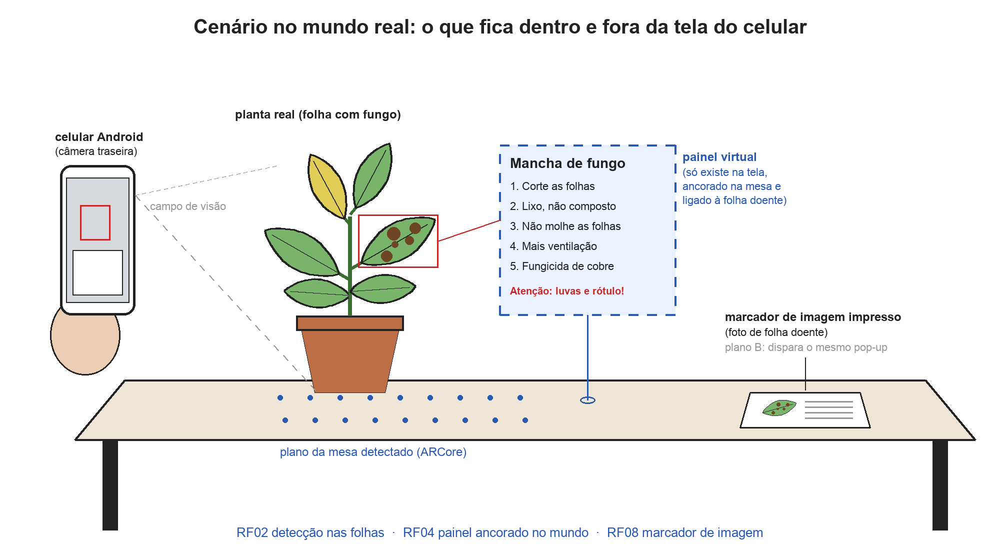

# CuidAR – Diagnóstico de Plantas em Realidade Aumentada

Aponte a câmera do celular para uma planta: o CuidAR marca as folhas com problema e mostra, num painel em Realidade Aumentada ao lado do vaso, o que a planta tem e como tratar.

Projeto da disciplina de Realidade Virtual (Ciência da Computação – FURB, 2026/2).

**Equipe:** João Fissmer ([@cyanide0081](https://github.com/cyanide0081)) e Pedro Scarelli ([@pedroscarelli](https://github.com/pedroscarelli))

**Kanban:** [GitHub Projects – cuidAR](https://github.com/users/pedroscarelli/projects/1)

## A ideia

Muita gente tem planta em casa e percebe que ela "está estranha" (folhas amarelas, manchas, pó branco, bichinhos), mas não sabe o que é nem o que fazer. O CuidAR usa uma rede neural rodando no próprio celular para identificar o problema em cada folha e mostra o tratamento direto no mundo real, preso à planta.

**Público-alvo:** pessoas com plantas em casa, varanda ou hortas (domésticas, escolares e comunitárias), principalmente iniciantes.

**Interdisciplinaridade:** Realidade Aumentada + Inteligência Artificial/visão computacional + Interação Humano-Computador + Biologia/Agronomia (fitopatologia) + Sustentabilidade.

## Objetivos

- Detectar em tempo real problemas visíveis nas folhas (folha amarelada, mancha de fungo, oídio e pragas) e folhas saudáveis, com uma rede neural (YOLOv8n) executada no aparelho.
- Exibir em RA, ao lado da planta, um diagnóstico sugerido e passos básicos e seguros de tratamento.
- Ajudar leigos a tratar os problemas cedo, evitando o uso desnecessário de produtos químicos.
- Manter a arquitetura extensível: novas doenças ou espécies exigem só um novo modelo e novos dados, sem mudar o código.

## Como funciona

```
câmera (AR Foundation) → modelo YOLO (Inference Engine) → estabilizador (3 detecções seguidas)
                       → tabela de tratamentos (ScriptableObject) → interface (pop-up / painel em RA)
```

Classes do modelo: `folha_saudavel`, `folha_amarelada`, `mancha_fungica`, `oidio`, `praga`.

## Requisitos funcionais

| ID | O usuário... | Tela |
|----|--------------|------|
| [RF01](https://github.com/pedroscarelli/cuidAR/issues/1) | abre o app, permite a câmera e vê a imagem em tempo real com os planos detectados | 1, 2 |
| [RF02](https://github.com/pedroscarelli/cuidAR/issues/2) | aponta para a planta e vê cada folha marcada com o problema encontrado ou como saudável | 2, 3 |
| [RF03](https://github.com/pedroscarelli/cuidAR/issues/3) | vê um pop-up com diagnóstico sugerido, passos de tratamento e aviso de segurança | 4 |
| [RF04](https://github.com/pedroscarelli/cuidAR/issues/4) | vê o painel de tratamento ancorado no mundo real, ao lado do vaso e ligado à folha doente | 6 |
| [RF05](https://github.com/pedroscarelli/cuidAR/issues/5) | recebe "Nenhum problema encontrado" quando a planta está saudável | 5 |
| [RF06](https://github.com/pedroscarelli/cuidAR/issues/6) | fecha o pop-up e escaneia de novo | 4 |
| [RF07](https://github.com/pedroscarelli/cuidAR/issues/7) | toca numa folha para ver o tratamento daquele problema, quando há mais de um | 3 |
| [RF08](https://github.com/pedroscarelli/cuidAR/issues/8) | usa um marcador de imagem impresso para disparar o mesmo pop-up (modo demonstração / plano B) | cenário |

## Protótipo das telas




## Tecnologias

- **Unity 6000.3.14f1** (template Universal 3D / URP), C#
- **AR Foundation** com **Apple ARKit** (iPhone) e **Google ARCore** (Android)
- **Unity Inference Engine** (antigo Sentis) para rodar o modelo ONNX no celular
- **YOLOv8n** (ultralytics) treinado no Google Colab, dados rotulados no Roboflow (PlantDoc, PlantVillage e fotos da equipe)
- **TextMeshPro** para a interface

## Requisitos não funcionais (resumo)

- **Desempenho:** câmera fluida (~30 fps), detecção 5 a 10 vezes por segundo, resultado em até ~1 s.
- **Confiabilidade:** confiança mínima de 0,5 com NMS; um problema só aparece após 3 detecções iguais seguidas.
- **Limitações:** funciona melhor de 20 a 50 cm da planta e com boa luz. O diagnóstico é uma sugestão e não substitui um agrônomo.
- **Usabilidade:** interface em português, cores por tipo de problema, no máximo um toque para cada ação.

## Documentação

O planejamento completo (público-alvo, contexto, objetivos e requisitos) está em [PlanejamentoAplicativo_CuidAR.docx](PlanejamentoAplicativo_CuidAR.docx).
