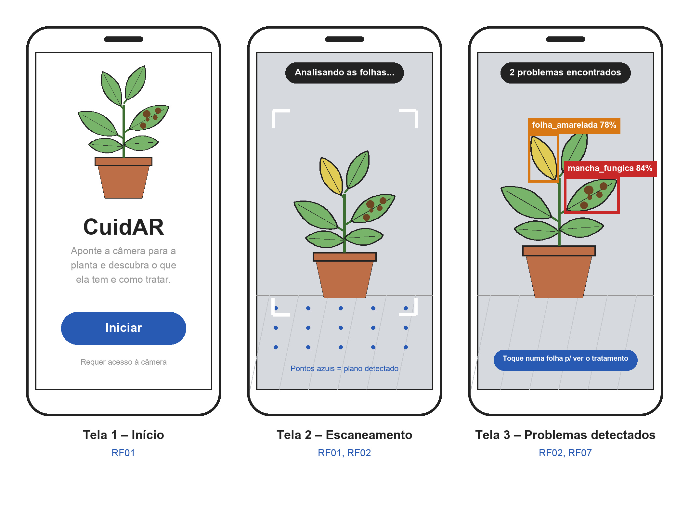
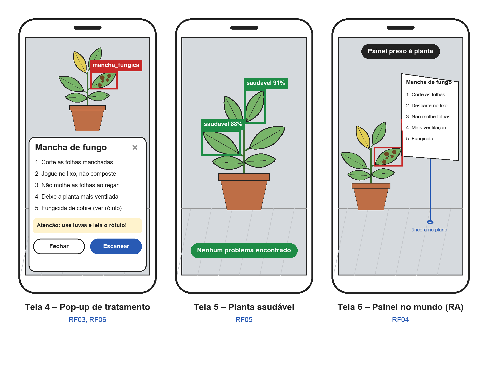

# CuidAR – Augmented Reality Plant Diagnosis

Point your phone's camera at a plant: CuidAR marks the leaves that have problems and shows, in an Augmented Reality panel next to the pot, what is wrong with the plant and how to treat it.

Project for the Virtual Reality course (Computer Science – FURB, 2026/2).

**Team:** João Fissmer ([@cyanide0081](https://github.com/cyanide0081)) and Pedro Scarelli ([@pedroscarelli](https://github.com/pedroscarelli))

**Kanban:** [GitHub Projects – cuidAR](https://github.com/users/pedroscarelli/projects/1)

## The idea

Lots of people have plants at home and notice that one "looks off" (yellow leaves, spots, white powder, little bugs), but don't know what it is or what to do. CuidAR uses a neural network running on the phone itself to identify the problem on each leaf and shows the treatment directly in the real world, anchored to the plant.

**Target audience:** people with plants at home, on balconies or in gardens (home, school and community gardens), especially beginners.

**Interdisciplinarity:** Augmented Reality + Artificial Intelligence/computer vision + Human-Computer Interaction + Biology/Agronomy (plant pathology) + Sustainability.

## Goals

- Detect visible leaf problems in real time (yellowing leaf, fungal spot, powdery mildew and pests) as well as healthy leaves, with a neural network (YOLOv8n) running on the device.
- Display in AR, next to the plant, a suggested diagnosis and basic, safe treatment steps.
- Help non-experts treat problems early, avoiding unnecessary use of chemicals.
- Keep the architecture extensible: new diseases or species only require a new model and new data, with no code changes.

## How it works

```
camera (AR Foundation) → YOLO model (Inference Engine) → stabilizer (3 consecutive detections)
                       → treatment table (ScriptableObject) → interface (pop-up / AR panel)
```

Model classes: `folha_saudavel`, `folha_amarelada`, `mancha_fungica`, `oidio` (healthy leaf, yellowing leaf, fungal spot, powdery mildew). `praga` (pest) is planned, but the current dataset has too few pest examples, so the first model does not include it.

## Functional requirements

| ID | The user... | Screen |
|----|-------------|--------|
| [RF01](https://github.com/pedroscarelli/plant-care-ar/issues/1) | opens the app, allows camera access and sees the live image with the detected planes | 1, 2 |
| [RF02](https://github.com/pedroscarelli/plant-care-ar/issues/2) | points at the plant and sees each leaf marked with the problem found or as healthy | 2, 3 |
| [RF03](https://github.com/pedroscarelli/plant-care-ar/issues/3) | sees a pop-up with a suggested diagnosis, treatment steps and a safety warning | 4 |
| [RF04](https://github.com/pedroscarelli/plant-care-ar/issues/4) | sees the treatment panel anchored in the real world, next to the pot and linked to the diseased leaf | 6 |
| [RF05](https://github.com/pedroscarelli/plant-care-ar/issues/5) | gets "No problem found" when the plant is healthy | 5 |
| [RF06](https://github.com/pedroscarelli/plant-care-ar/issues/6) | closes the pop-up and scans again | 4 |
| [RF07](https://github.com/pedroscarelli/plant-care-ar/issues/7) | taps a leaf to see the treatment for that problem, when there is more than one | 3 |
| [RF08](https://github.com/pedroscarelli/plant-care-ar/issues/8) | uses a printed image marker to trigger the same pop-up (demo mode / plan B) | scenario |

## Screen prototypes






## Technologies

- **Unity 6000.6.9f1** (Universal 3D / URP template), C#
- **AR Foundation** with **Apple ARKit** (iPhone) and **Google ARCore** (Android)
- **Unity Inference Engine** (formerly Sentis) to run the ONNX model on the phone
- **YOLOv8n** (ultralytics), first version trained on [PlantDoc](https://github.com/pratikkayal/PlantDoc-Object-Detection-Dataset) (CC BY 4.0); photos taken by the team will be added later
- **TextMeshPro** for the interface

## Non-functional requirements (summary)

- **Performance:** smooth camera (~30 fps), detection 5 to 10 times per second, result within ~1 s.
- **Reliability:** minimum confidence of 0.5 with NMS; a problem only appears after 3 identical consecutive detections.
- **Limitations:** works best 20 to 50 cm from the plant and in good lighting. The diagnosis is a suggestion and does not replace an agronomist.
- **Usability:** Portuguese-language interface, colors by problem type, at most one tap per action.

## Documentation

The full plan (target audience, context, goals and requirements) is in [PlanejamentoAplicativo_CuidAR.docx](PlanejamentoAplicativo_CuidAR.docx) (in Portuguese).

## Running the project

Requirements: Unity **6000.6.9f1** with the **Android Build Support** and/or **iOS Build Support** modules; Xcode for iPhone.

1. Open the project in Unity Hub. On first open, Unity downloads the packages (AR Foundation, ARCore, ARKit, Inference Engine).
2. **Edit → Project Settings → XR Plug-in Management**: on the Android tab, *Google ARCore* is already checked; on the **iOS tab, check *Apple ARKit*** (only needed once; Unity creates the files in `Assets/XR`).
3. **File → Build Profiles**: add `Assets/Scenes/MainMenu.unity` (index 0) and `Assets/Scenes/ARScene.unity`.
4. Build:
   - **Android:** switch to Android, connect the phone with USB debugging on, then *Build And Run*.
   - **iPhone:** switch to iOS, *Build*, open the generated `Unity-iPhone.xcodeproj` in Xcode, select your Apple ID team under *Signing & Capabilities* (a free account is enough, no App Store needed), then run on the iPhone. With a free account the app must be reinstalled every 7 days, and you need to trust the developer in *Settings → General → VPN & Device Management*.

### Testing without a phone

In the `SceneController` object of `ARScene`, the `CuidARController` component has two debug options:

- **Fake Detections:** draws example boxes, to test the interface in the Editor (with XR Simulation) without a model.
- **Show Model Input:** shows, in the bottom-left corner, the image the model receives. If it appears upside down, check **Flip Model Input**.

## Detection model

- Files: `Assets/Resources/Models/cuidar_yolov8n.onnx` (model) and `cuidar_labels.txt` (one class per line, in the model's order). To use a new model, just replace both files.
- Input: 640x640 RGB image (the centered square of the screen, shown as the scan frame). Output: `[1, 4 + classes, 8400]`.
- Runs on the GPU every 4 frames; boxes below 0.5 confidence are discarded, overlapping boxes are merged (NMS), and a box only appears after 3 consecutive detections.
- Training (reproducible): PlantDoc converted to the 4 classes, then `yolo detect train model=yolov8n.pt imgsz=640` and `yolo export format=onnx opset=15 imgsz=640`.
- Known limitation: PlantDoc contains crop plants (tomato, potato, corn, apple...), not houseplants, so accuracy on houseplants will be lower until we add our own photos.
